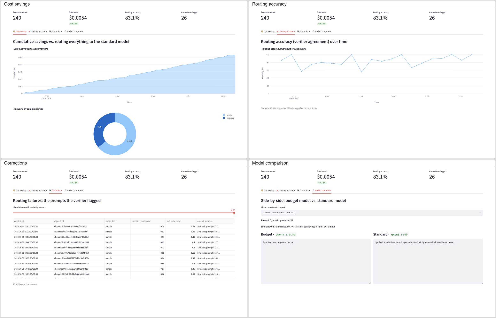
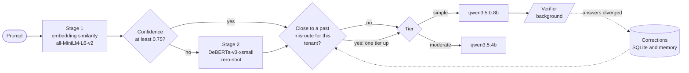

# llm-cost-autopilot

Routes each LLM request to the cheapest model tier that can handle it, for teams that send every prompt to one mid-size model and pay for it.

[](https://github.com/adel-saoud/llm-cost-autopilot/actions/workflows/ci.yml)
[](pyproject.toml)
[](LICENSE)



*Dashboard on a synthetic ledger. Its figures are not measurements; see [Results](#results).*

## Why

A lookup like "what is the capital of France?" costs as much as a multi-step
design question when both go to the same model. Picking the model per
request needs a decision that is fast, needs no labelled data, and can be
checked after the fact.

## Try it

### Requirements

- Python 3.12 or newer and uv 0.13.
- For the full stack: Docker, or Ollama 0.17.5 or newer with `qwen3.5:0.8b`
  and `qwen3.5:4b` pulled. Startup stops on an older Ollama, naming the
  minimum, and on an `AUTOPILOT_*` variable that is not a setting.

### Run it

No API key, no model download. Seeds a synthetic ledger and opens the
dashboard (about a minute on a cold uv cache):

```bash
git clone https://github.com/adel-saoud/llm-cost-autopilot
cd llm-cost-autopilot
uv run --extra dashboard python scripts/seed_demo_ledger.py autopilot-demo.db
AUTOPILOT_SQLITE_PATH=autopilot-demo.db uv run --extra dashboard streamlit run src/llm_cost_autopilot/dashboard/app.py
```

The full stack routes real requests through local Ollama models. It is slower
the first time: the image installs torch and Ollama pulls about 5 GB.

```bash
docker compose up -d
docker compose exec ollama ollama pull qwen3.5:0.8b
docker compose exec ollama ollama pull qwen3.5:4b

curl -s -X POST http://localhost:8000/v1/chat/completions \
  -H 'content-type: application/json' \
  -d '{"messages":[{"role":"user","content":"What is the capital of France?"}]}' \
  -D - -o /dev/null | grep -i '^x-autopilot'
```

Each response carries its decision trail (`x-autopilot-complexity-tier`,
`x-autopilot-model-used`, `x-autopilot-routing-reason`, cost and savings).
Endpoints and headers: [docs/api.md](docs/api.md).

## How it works



1. **Stage 1** compares the prompt with anchor prompts for each tier (5
   simple, 10 moderate). Above
   0.75 cosine similarity it decides with no model inference.
2. **Stage 2** runs a DeBERTa-v3-xsmall zero-shot pipeline when stage 1 is
   unsure (median 43 ms in the evaluation, on a machine shared with other work).
3. **The verifier** replays each cheap answer on the standard model in the
   background, bounded by a semaphore and a pending cap, and records a
   correction when the two answers diverge. It never delays the response.
4. **The correction memory** keeps each correction's embedding per tenant. A
   later prompt at least 0.80 similar to one, and closer to it than to the
   anchors of the tier it was misrouted to, goes one tier up.

`POST /v2/route` returns the decision alone (tier, confidence, reason) for
[llm-gateway](https://github.com/adel-saoud/llm-gateway). Components, data
model and failure modes: [docs/architecture.md](docs/architecture.md).

## Results

1,000 measured requests per run on `qwen3.5:0.8b` and `qwen3.5:4b` with
thinking off, Apple M4 Pro: 500 factual questions from
[NQ-Open](https://huggingface.co/datasets/google-research-datasets/nq_open)
with paraphrases written by `llama3.2:3b`, plus 350 moderate and 150
multi-step prompts (writing, extraction, planning) from the bundled pools. Quality is the gold accuracy of the answer
served, not agreement with the bigger model. Run A has the correction memory
off, run B on; both runs read the same cached answers (temperature 0, fixed
seed).

| | Run A: memory off | Run B: memory on |
|:--|:--|:--|
| Cost reduction vs sending everything to `qwen3.5:4b` | 1.3% | 1.3% |
| Gold accuracy, reworded versions of past questions (n=250) | 36.4% | 36.4% |
| Gold accuracy, questions never seen before (n=250) | 32.4% | 32.4% |
| QA prompts sent to the cheap model (n=500) | 2.4% | 2.4% |
| QA prompts escalated by a past correction | 0% | 0% |

The same 500 questions asked of each model directly, whatever the router
decided:

| Model | Gold accuracy (n=500) |
|:--|:--|
| `qwen3.5:0.8b` (simple tier) | 16.8% |
| `qwen3.5:4b` (moderate tier) | 35.6% |

Latency per tier, timed alone on 20 uncached questions each, nothing else
loaded on Ollama ([results/tier_latency.json](results/tier_latency.json)):

| Model | Median | p95 | Output tokens/s |
|:--|:--|:--|:--|
| `qwen3.5:0.8b` (simple tier) | 792 ms | 1,374 ms | 187 |
| `qwen3.5:4b` (moderate tier) | 3,437 ms | 5,828 ms | 65 |

- **On factual questions the cheap model is half as accurate.** That makes
  the router's caution correct here: it sends 12 of 500 questions to the cheap
  model and saves 1.3%.
- **The classifier sees almost every question as moderate.** Stage 1 decided
  no request, so the stage 2 zero-shot model routes everything, and it labels
  nearly all factual questions "reasoning, writing or analysis".
- **The correction memory never fired.** With so few cheap answers, the
  verifier recorded one correction (precision 100%, n=1) and caught 5.3% of
  the cheap model's wrong answers (n=19), so run B equals run A and the
  pre-registered bar was not met.
- **Savings are capped by the price gap.** The two models' list prices differ
  by 3x, so at equal token counts a request routed to the cheap model saves
  about two thirds of its cost, and the run saves only what it routes.

Costs are simulated (Ollama is free) at DeepInfra's list prices for the same
two models, read on 2026-10-24 ([table](docs/configuration.md#simulated-prices)). Method, bootstrap and per-split numbers:
[docs/eval-feedback-loop.md](docs/eval-feedback-loop.md). Every number
above, with its sample size, versions, model digests and seed, is in
[results/manifest.json](results/manifest.json). Reproduce with Ollama running
both models:

```bash
uv run --extra ml python scripts/reproduce.py
```

The script asks both models for every prompt, four calls at a time, into a
response cache, then replays the two runs one request at a time from it.
The published numbers come from the frozen eval set, whose paraphrases were
written by `llama3.2:3b`. `scripts/build_feedback_eval_set.py` now defaults to
the moderate-tier model, so rebuilding it produces a different eval set.

The frozen eval set is [eval_data/nq_open_paraphrases.jsonl](eval_data/nq_open_paraphrases.jsonl):
questions and answers from NQ-Open (Google, CC BY-SA 3.0) with model-written
paraphrases, shared under the same licence ([eval_data/README.md](eval_data/README.md)).
The MIT licence covers the code, not this file.

## Design decisions

- [Two-stage zero-shot classifier](docs/adr/0001-two-stage-classifier.md): embedding anchors first, DeBERTa zero-shot only when unsure, no labelled data.
- [Two tiers on one model family at list prices](docs/adr/0005-two-tiers-one-model-family-list-prices.md): `qwen3.5:0.8b` and `qwen3.5:4b`, which took measured savings from 6.9% to 1.3%.
- [Keep the correction memory after a negative result](docs/adr/0007-keep-correction-memory-after-negative-result.md): the pre-registered bar was not met, so the README claims no gain.

All decisions: [docs/adr/README.md](docs/adr/README.md).

## Limits

- **The correction memory was tried and did not help** on the measured mix
  (see Results). It stays in the code and is switched off with
  `AUTOPILOT_CORRECTION_FEEDBACK_ENABLED=false`.
- **Stage 2 runs on nearly every real request.** Stage 1's anchors rarely
  reach 0.75 on real questions, so most requests pay about 43 ms of NLI
  inference ([ADR 0001](docs/adr/0001-two-stage-classifier.md)).
- **Savings depend on the prompt mix and the price gap.** 1.3% on the mix
  above at a 3x price gap. A wider gap or more short lookups would save more.
- **The verifier compares answers, it does not judge them.** Some "diverged"
  rows are style differences, and each can escalate later prompts.
- **A false correction is not undone.** Escalated prompts are not verified
  again, so a bad correction stays until retention or the per-tenant cap
  drops it.
- **One process per ledger.** The memory lives in process; with several
  workers each sees only its own traffic.
- **`/v2/route` traffic adds no corrections.** Only requests autopilot serves
  itself are verified.

## Part of a system

- [llm-gateway](https://github.com/adel-saoud/llm-gateway) calls `POST /v2/route` for a tier, serves the request with its own providers and routes as if autopilot were absent when the call fails.
- [llm-regression-detector](https://github.com/adel-saoud/llm-regression-detector) catches quality drops in CI when a prompt or a model changes.

## Development

```bash
uv sync
uv run pre-commit install --hook-type pre-commit --hook-type commit-msg
uv run pre-commit run --all-files
uv run pytest
```

Tests are hermetic: the HuggingFace models, Ollama and the scorer are faked.
Layout and tech stack: [docs/project-structure.md](docs/project-structure.md).
Settings: [docs/configuration.md](docs/configuration.md). Open work:
[docs/roadmap.md](docs/roadmap.md).

## License

[MIT](LICENSE)
