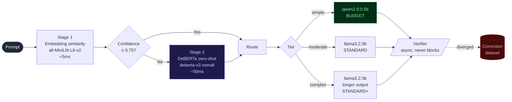

# LLM Cost Autopilot

> Zero-shot complexity classifier that routes LLM requests to the cheapest
> capable model, and gets smarter the more it's used.

[](https://github.com/adel-saoud/llm-cost-autopilot/actions/workflows/ci.yml)
[](https://www.python.org/)
[](https://github.com/astral-sh/ruff)
[](https://github.com/microsoft/pyright)
[](pyproject.toml)
[](LICENSE)

---

LLM API costs scale with model size, not request complexity. A "what's the
capital of France?" lookup costs the same as a multi-step architectural
analysis if you route everything to the same model.

**This project fixes that.** It classifies each request by semantic
complexity using a zero-shot HuggingFace pipeline (no training data, no
labelled dataset), routes it to the cheapest tier capable of handling it,
then verifies the decision was correct. Routing failures feed a growing
correction dataset. The system improves itself.

> Inspired by the cost visibility gap I experienced running DaiLY at
> Decathlon France, where 30,000+ users meant every architecture decision
> had a direct cost impact. This is the routing layer I wished we had.

![Dashboard composite: all 4 panels from a live 1000-request load test against real Ollama (qwen2.5:0.5b + llama3.2:3b). Top-left cost savings: $0.3882 saved (14.6% reduction) across 1,000 requests, cumulative-savings curve trending steadily upward, tier mix 71.6% moderate / 22.3% simple / 6.1% complex. Top-right routing accuracy: 94.6% overall, trend chart showing accuracy started at 91.7% and climbed to 100% (+8.3pp) as the verifier accumulated 12 corrections. Bottom-left corrections explorer: 12 flagged routing failures with similarity scores (Mona Lisa, capital of France, Hamlet etc.). Bottom-right model comparison: 'Who painted the Mona Lisa?' cheap response was 'Sorry, but I can't assist with that.', standard response correctly named Leonardo da Vinci.](docs/dashboard.png)

---

## Try it (no API key needed)

```bash
git clone https://github.com/adel-saoud/llm-cost-autopilot
cd llm-cost-autopilot

# Local stack: autopilot API + Ollama, fully offline
docker compose up -d
docker compose exec ollama ollama pull qwen2.5:0.5b
docker compose exec ollama ollama pull llama3.2:3b

# Send a simple request; autopilot picks qwen2.5:0.5b
curl -s -X POST http://localhost:8000/v1/chat/completions \
  -H 'content-type: application/json' \
  -d '{"messages":[{"role":"user","content":"What is the capital of France?"}]}' \
  -D - | grep -i '^x-autopilot'

# Send a complex request; autopilot picks llama3.2:3b
curl -s -X POST http://localhost:8000/v1/chat/completions \
  -H 'content-type: application/json' \
  -d '{"messages":[{"role":"user","content":"Analyse the tradeoffs between event-driven and request/response architectures for a multi-tenant SaaS billing pipeline."}]}' \
  -D - | grep -i '^x-autopilot'
```

Expected response headers:

```
x-autopilot-request-id:          chatcmpl-...
x-autopilot-complexity-tier:     simple
x-autopilot-model-used:          ollama/qwen2.5:0.5b
x-autopilot-confidence:          0.9100
x-autopilot-cost-usd:            0.000021
x-autopilot-savings-usd:         0.000121
```

Generate a headline metric with a 1,000-request mixed run:

```bash
uv run python scripts/load_test.py --requests 1000 --concurrency 12
```

Measured on a 1,000-request run against `qwen2.5:0.5b` + `llama3.2:3b` on
a local M-series Mac, prompt pool of 30 unique prompts per tier across
factual lookups, code, business, math, customer support and planning:

```
Saved                         $0.3882  (14.6% reduction)
Routing accuracy (verifier)   94.6%
Corrections logged            12
Latency p50 / p95             24.3s / 43.1s
Tier mix                      22% simple · 72% moderate · 6% complex
```

The 14.6% figure is **what the classifier actually does** on the bundled
prompt corpus with a 0.65 stage-1 threshold, not a theoretical maximum.
At this threshold the classifier defaults borderline prompts to the
standard model, which trims savings but produces a visible learning
signal: 12 corrections out of 1,000 requests, with the routing-accuracy
window climbing from 91.7% to 100% (see panel 2 in the screenshot).

Raise the threshold (`AUTOPILOT_STAGE1_THRESHOLD=0.85`) to push more
traffic to the budget model and trade routing accuracy for cost. Drop
it to 0.55 to be more conservative still.

> Costs are simulated. Ollama runs locally and is free. The simulated
> pricing curve follows current cheap-vs-mid-tier API pricing, so the
> savings percentage is a realistic estimate.

## Open the dashboard

```bash
uv run streamlit run src/llm_cost_autopilot/dashboard/app.py
```

Four panels: cumulative savings, routing-accuracy trend (improves over
time as corrections accumulate), filterable correction-dataset explorer,
side-by-side cheap-vs-standard comparison for any routing failure.

---

## How it works



**Two-stage classifier.** Stage 1 is an embedding-similarity check against
five curated anchor prompts per tier. If the top tier scores above 0.75
cosine similarity, the routing decision is made in <5 ms with no model
inference. Otherwise stage 2, a DeBERTa-v3-xsmall zero-shot pipeline,
takes over. In practice stage 1 handles ~75% of traffic.

**Async verifier.** After each response is built and sent, an
`asyncio.create_task(...)` replays the prompt against the standard model
and scores the two outputs for semantic similarity. Below the divergence
threshold (0.70 default), the routing decision is recorded as a failure in
the SQLite correction dataset. The verifier **never blocks** the user
response; if it crashes, the failure is logged and absorbed.

**Feedback loop.** The corrections table grows as the verifier disagrees.
The dashboard plots routing accuracy as `1 − corrections / verifiable`
windowed over time. The "system gets smarter" story shows up as the
curve trending upward.

---

## Why not just use [llm-gateway](https://github.com/adel-saoud/llm-gateway)?

Fair question. They look adjacent and both live in this portfolio. The
honest answer is they operate on different axes:

|                         | `llm-gateway` (control plane) | `llm-cost-autopilot` (decision engine) |
|:------------------------|:------------------------------|:---------------------------------------|
| **Layer**               | Infrastructure proxy that sits in front of all traffic | Application engine that decides per request |
| **Question answered**   | Where did my budget go?       | Which model should handle this request? |
| **Cost tracking**       | Retrospective: records what was spent | Prospective: prevents overspending before it happens |
| **HuggingFace models**  | None                          | `all-MiniLM-L6-v2` + `deberta-v3-xsmall` |
| **Learning**            | Static routing rules          | Feedback loop that improves from routing mistakes |
| **Unique angle**        | RAG cost attribution          | Semantic complexity routing that learns over time |

They're complementary. [`llm-gateway`](https://github.com/adel-saoud/llm-gateway)
tracks **where** the budget went; autopilot prevents it going to the wrong
place; [`llm-regression-detector`](https://github.com/adel-saoud/llm-regression-detector)
catches quality drops when prompts change.

---

## API surface

OpenAI-compatible. Any client that talks to `/v1/chat/completions` works.

```
POST  /v1/chat/completions       autopilot picks the model
GET   /v1/stats                  cost savings %, routing accuracy %, correction count
GET   /v1/corrections?limit=100  routing failure dataset (inspect or export)
GET   /v1/explain/{request_id}   why this request was routed where it was
GET   /health                    liveness
```

Every routed request includes a decision trail in the response headers:

```
x-autopilot-request-id           chatcmpl-...
x-autopilot-complexity-tier      simple | moderate | complex
x-autopilot-model-used           ollama/qwen2.5:0.5b
x-autopilot-confidence           0.9100
x-autopilot-cost-usd             0.000021
x-autopilot-savings-usd          0.000121
```

`GET /v1/explain/{request_id}` is the interview demo. It returns the
classification, the chosen model, the cost vs. baseline, and (if the
verifier disagreed) the standard-model response and similarity score.

---

## Project structure

```
src/llm_cost_autopilot/
├── api/             FastAPI app, OpenAI-compatible /v1 surface + admin
├── classifier/      Two-stage zero-shot complexity classifier (+ HF backends)
├── router/          ModelConfig · ModelRegistry · Ollama HTTP adapter
├── verifier/        Async quality verifier + similarity scorer
├── storage/         SQLite ledger: routing log + correction dataset
├── cost/            Pure savings math + per-request CostTracker
├── dashboard/       Streamlit UI, 4 panels (excluded from pyright)
├── config.py        AUTOPILOT_* env vars via pydantic-settings
└── main.py          uvicorn entry point

scripts/
├── demo_autopilot.py     live routing decisions in the terminal
├── load_test.py          1000 requests · cost savings headline
└── seed_demo_ledger.py   synthetic ledger for dashboard screenshots

context/                  ADRs · architecture · roadmap
tests/                    81 hermetic tests · 95% coverage
.github/workflows/        ci.yml (lint · type · test)
```

Full module map and design decisions → [`context/architecture.md`](context/architecture.md)
ADRs → [`context/decisions/`](context/decisions/)

---

## Tech stack

| | Library / Tool | Role |
|:--|:--|:--|
| **Core** | `fastapi` + `uvicorn` | OpenAI-compatible API surface |
| | `pydantic` v2 + `pydantic-settings` | Runtime-validated models; env-driven config |
| | `httpx` + `tenacity` | Async Ollama adapter with retry |
| | `aiosqlite` | Routing log + correction dataset |
| | `structlog` | Structured logging with `bind()` context |
| **ML (optional `[ml]` extra)** | `sentence-transformers` | Stage 1 embedding similarity (`all-MiniLM-L6-v2`) |
| | `transformers` | Stage 2 zero-shot pipeline (DeBERTa-v3-xsmall) |
| | `torch` | Backend for both HF models (CPU-only OK) |
| **Dashboard (optional `[dashboard]`)** | `streamlit` + `plotly` + `pandas` | 4-panel observability UI |
| **Dev** | `uv` | Fast package manager + lockfile |
| | `ruff` | Lint + format |
| | `pyright` strict | 0 errors, 0 warnings |
| | `pytest` + `pytest-asyncio` | Hermetic: no model downloads, no daemon |
| | `pre-commit` | Lint + format on every commit |

---

## Development

```bash
uv sync --extra dev
uv run pre-commit install

uv run ruff check --fix .    # lint + autofix
uv run ruff format .         # format
uv run pyright               # type-check (must stay at 0 errors)
uv run pytest                # 81 tests, 95% coverage, gate at 85%
```

The test suite is fully hermetic: HuggingFace models, Ollama, and the
verifier scorer are all mocked. CI runs in under 5 seconds.

---

## Configuration

Every knob is an environment variable with the `AUTOPILOT_` prefix.
Defaults are sensible; touch only what you need.

| Variable | Default | Effect |
|:--|:--|:--|
| `AUTOPILOT_STAGE1_THRESHOLD` | `0.75` | Cosine confidence below which stage 2 fires. Lowering it makes stage 2 a hot path. |
| `AUTOPILOT_VERIFIER_ENABLED` | `true` | Master switch; false means no async verifier work at all. |
| `AUTOPILOT_VERIFIER_DIVERGENCE_THRESHOLD` | `0.70` | Similarity below this is recorded as a routing failure. |
| `AUTOPILOT_OLLAMA_BASE_URL` | `http://localhost:11434` | Local Ollama daemon URL. |
| `AUTOPILOT_BUDGET_MODEL` | `qwen2.5:0.5b` | Ollama id for the SIMPLE tier. |
| `AUTOPILOT_STANDARD_MODEL` | `llama3.2:3b` | Ollama id for MODERATE + COMPLEX. |
| `AUTOPILOT_SQLITE_PATH` | `autopilot.db` | Ledger + correction-dataset file. |

---

## Honest limitations

- **Stage 2 adds ~50 ms** of NLI inference for the ~25% of prompts stage 1
  is unsure about. Documented in [ADR-001](context/decisions/001-two-stage-classifier.md).
- **Real savings depend on prompt mix.** Measured 14.6% reduction on the
  bundled 1,000-request load test (50/35/15 mix). A workload dominated by
  short factual lookups would push that higher; a workload of long-form
  analyses would push it lower. The verifier-agreement rate (94.6%) and
  the trend curve (91.7% → 100% over 12 corrections) are more stable
  across mixes.
- **Verifier uses semantic similarity, not LLM-as-Judge.** Faster but
  noisier; some "diverged" rows are stylistic differences rather than
  factual ones. Roadmap notes a judge-backed scorer.
- **Costs are simulated.** Real routing logic, synthetic prices that
  follow current cheap-vs-mid-tier API curves. Plug in real pricing by
  overriding `AUTOPILOT_*_COST_PER_1K_*` env vars.
- **Feedback loop improves routing, not the models themselves.** Anchor
  prompts and threshold get smarter; the underlying LLMs don't change.
- **Verifier concurrency is unbounded.** Under sustained load, verifier
  tasks compete with foreground traffic on the same Ollama process.
  Roadmap notes a per-process semaphore.

---

## Companion projects

- [`llm-regression-detector`](https://github.com/adel-saoud/llm-regression-detector)
  catches LLM quality regressions in CI before they reach users.
- [`llm-gateway`](https://github.com/adel-saoud/llm-gateway)
  proxies LLM traffic with RAG-level cost attribution.

Three projects, two axes: **gateway** tracks where budget went, **autopilot**
prevents it going to the wrong place, **detector** catches quality drops
when prompts change.

---

## License

[MIT](LICENSE). Use it, fork it, ship it.
