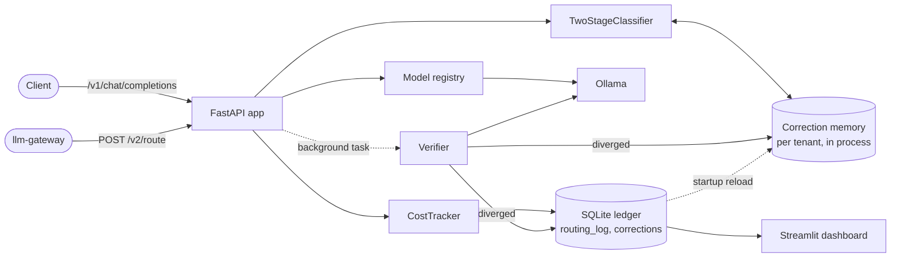

# Architecture

## One-paragraph summary

The autopilot is a thin async layer in front of a local LLM (Ollama). Every
request first goes through a **two-stage zero-shot classifier**: a fast
embedding-similarity pass (<5 ms), escalating to DeBERTa-v3-xsmall zero-shot
classification when stage 1 is unsure. On the NQ-Open eval stage 1 decided
none of the requests, so stage 2 does most of the routing on real questions.
The classified tier picks a model from a frozen registry. After the response
returns, an **async verifier** replays the prompt against the standard model
and scores the two outputs for semantic similarity. Divergences are persisted
as routing-failure rows in SQLite and added to a per-tenant **correction
memory**. The classifier searches that memory on every request, so a prompt
close to a past misroute is sent one tier up instead of repeating the
mistake. `POST /v2/route` exposes the routing decision alone for an upstream
gateway.

## Components and data flow



`/v2/route` stops after the classifier: the gateway gets a tier and serves
the request with its own providers, so nothing on that path is verified.

## Layered module map

```
api/             FastAPI surface: OpenAI-compatible /v1/chat/completions
  ├ app.py       lifespan + DI wiring
  ├ completions.py  routing endpoint (classify → route → call → verify)
  ├ route.py        /v2/route: decision only, for llm-gateway
  ├ stats.py        /v1/stats · /v1/corrections · /v1/explain/{id}
  ├ dependencies.py DI wiring + bearer-token check
  ├ health.py       /health
  └ schemas.py      request/response pydantic models

classifier/      Two-stage zero-shot classifier
  ├ complexity.py    ComplexityTier · tier_rank · ClassificationResult
  ├ zero_shot.py     TwoStageClassifier (orchestrator + anchors + correction rule)
  ├ correction_memory.py  per-tenant nearest-neighbour store of past misroutes
  └ huggingface_backends.py  HF model wrappers (lazy ML imports)

router/          Tier → model mapping + Ollama adapter
  ├ models.py        ModelConfig · ModelRegistry (frozen, exhaustive) · build_default_registry
  ├ pricing.py       MODEL_PRICES: simulated price per Ollama model, with its source
  └ ollama.py        OllamaClient (async, tenacity retry, errors as OllamaError)

verifier/        Async quality verifier + feedback loop
  ├ async_verifier.py  Verifier (fire-and-forget)
  ├ feedback.py        RoutingFailure · VerificationOutcome
  ├ correction_feedback.py  ledger write → memory add; startup reload
  └ embedding_scorer.py    EmbeddingSimilarityScorer (lazy ML imports)

storage/         Persistent ledger
  └ db.py        SQLiteLedger · open_ledger · RoutingLogEntry · Stats

cost/            Pure savings math + per-request tracker
  ├ calculator.py  compute_savings (pure)
  └ tracker.py     CostTracker (orchestrates ledger writes)

dashboard/       Streamlit UI (excluded from pyright + coverage)
  └ app.py       4 panels: savings · accuracy trend · corrections · comparison

config.py        AUTOPILOT_* env vars via pydantic-settings
main.py          uvicorn entry point
```

## Request lifecycle

1. **Receive**: FastAPI deserialises the OpenAI-compatible chat-completions body.
2. **Classify**: `TwoStageClassifier.classify(last_user_message, tenant_id=...)`
   runs in `asyncio.to_thread` so the CPU-bound embedding work doesn't block
   the loop. After stage 1 (and stage 2 if needed), the correction rule runs:
   if the tenant has stored corrections, the nearest one applies when its
   cosine similarity is at least `AUTOPILOT_CORRECTION_MATCH_THRESHOLD`, it
   beats the prompt's best anchor score for the misrouted tier, and the
   anchors alone would have routed below the correction's target tier.
3. **Route**: `registry.for_tier(tier)` picks a `ModelConfig`.
4. **Generate**: `OllamaClient.chat(...)` posts to local Ollama; retries on
   transport errors and 5xx, fails fast on 4xx.
5. **Record**: `CostTracker.record(...)` computes actual + baseline cost and
   inserts one `routing_log` row.
6. **Verify (background)**: `Verifier.verify_in_background(...)` schedules an
   `asyncio.Task` named `verifier:{request_id}`. The task replays the prompt on
   the standard model under a semaphore, scores similarity, and on divergence
   writes a `corrections` row and adds the prompt's embedding to the memory.
   Tasks are held in a set until done; beyond `AUTOPILOT_VERIFIER_MAX_PENDING`
   new ones are skipped as `skipped_overloaded`. All errors stay inside the task.
7. **Return**: response carries `X-Autopilot-*` headers describing the
   decision trail (model used, tier, confidence, routing reason, cost,
   savings, request id).

## Data model

Two tables plus a version row. Schema v3; `migrate()` upgrades older files
in place, one ordered step per version.

- `routing_log` (PK `request_id`, indexed on `created_at`): one row per
  routed request. Captures the tenant, the classification (stage
  `correction_memory` when a correction escalated it, plus
  `matched_correction_request_id`), the chosen model, token counts, actual
  and baseline cost, latency.
- `corrections` (autoincrement `id`, indexed on `request_id` and
  `created_at`): one row per verifier disagreement, with its tenant.
  Denormalised by design: meant to be inspected stand-alone.
- `schema_version`: single row recording `CURRENT_SCHEMA_VERSION`. The
  app refuses to start against a newer schema than it understands.

Both tables hold raw prompts. Rows older than `AUTOPILOT_RETENTION_DAYS`
(default 30) are deleted at startup. The correction memory is rebuilt from
the remaining rows, keeping only corrections made by the configured
cheap/standard model pair and at most `AUTOPILOT_CORRECTION_MAX_PER_TENANT`
per tenant.

## Concurrency model

- Single Ollama process, single SQLite file: both serialised internally.
- `WAL` journal mode so the dashboard can read while the API writes.
- One `httpx.AsyncClient` per process, shared across requests.
- Verifier calls to the standard model are capped by a semaphore
  (`AUTOPILOT_VERIFIER_MAX_CONCURRENCY`, default 2) and the waiting queue by
  `AUTOPILOT_VERIFIER_MAX_PENDING` (default 100).
- The correction memory lives in process memory. Run one worker per ledger:
  with several workers each one learns only from its own traffic.

## Failure modes

| Failure | Behaviour |
|:--|:--|
| Ollama down, timing out or returning 5xx | `OllamaClient` retries with tenacity, then `/v1/chat/completions` returns 502. No tier fallback. |
| Ollama returns 4xx | No retry; 502 with the Ollama error. |
| Verifier backlog above `AUTOPILOT_VERIFIER_MAX_PENDING` | New verifications are skipped and logged as `skipped_overloaded`. The response is never delayed. |
| Verifier task raises | The error is logged inside the task; the user response already left. |
| Ledger written by a newer schema version | The app refuses to start instead of reading columns it does not know. |
| `[ml]` extra not installed | Startup fails in the lifespan when the HuggingFace backends import. |
| Ollama older than 0.17.5, or its version unreadable | Startup fails with `OllamaVersionError` naming the minimum. |
| Unknown `AUTOPILOT_*` variable | Startup fails with `UnknownSettingError` naming the closest valid setting. |
| Configured model missing from the price table | Startup fails naming `router/pricing.py`, instead of reporting free requests. |
| `AUTOPILOT_API_TOKEN` unset | The API starts open and logs `app.lifespan.api_open`. |
| A false correction | Escalated prompts are not verified again, so it stays until retention or the per-tenant cap drops it. |
| Several workers on one ledger | Each worker's correction memory sees only its own traffic. |

## What's deliberately out of scope

- Real paid API keys / per-tenant rate limits (the gateway owns those).
- Active retraining of the classifier (it's zero-shot: no training set).
- Kubernetes / service mesh.
- Semantic caching (different problem, see `llm-gateway`).
